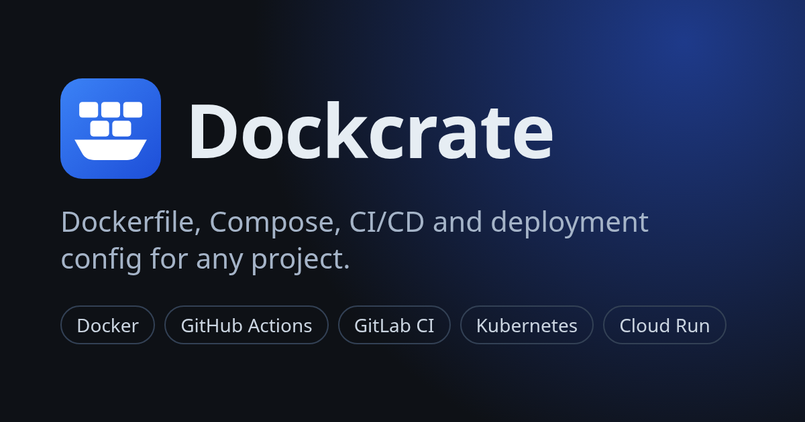
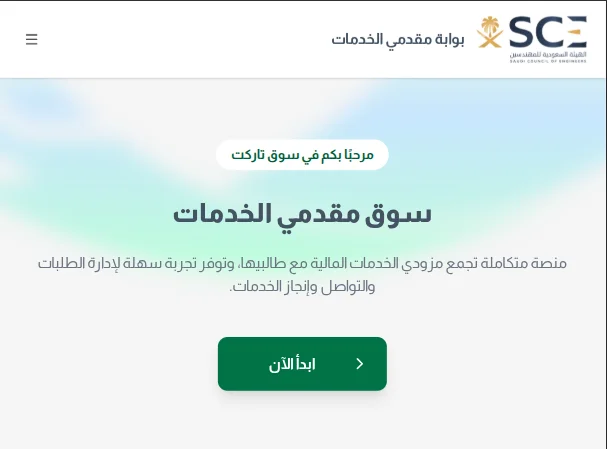
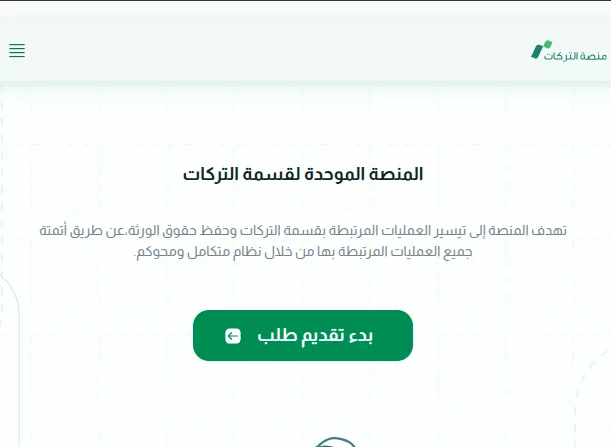
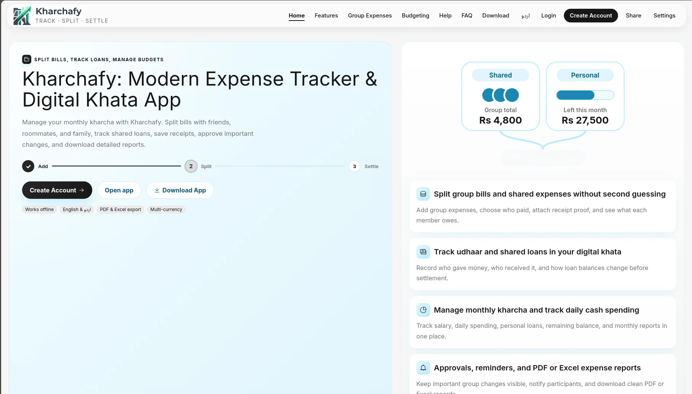
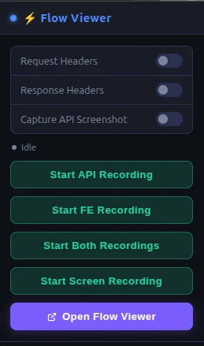
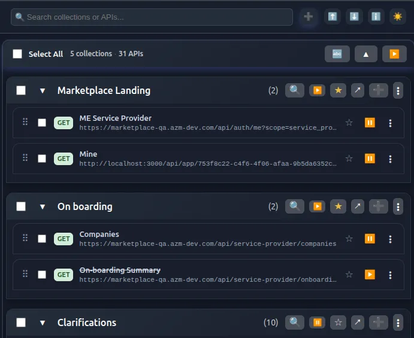
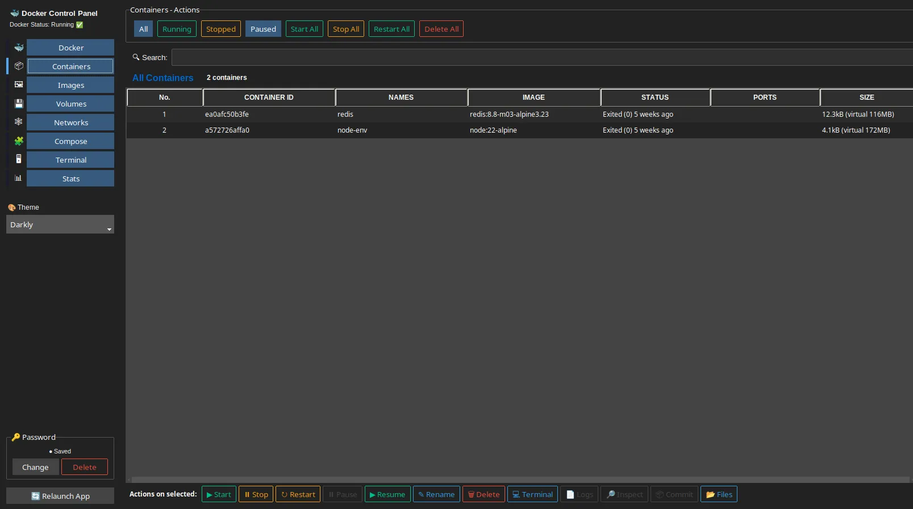
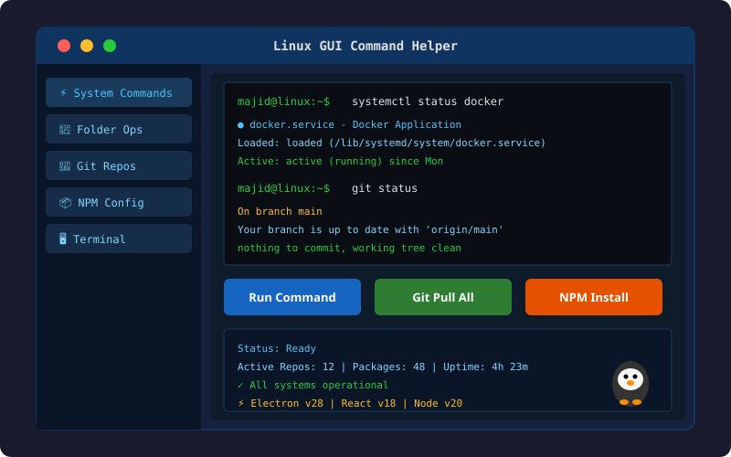

# Hi 👋, I'm Majid Ali

### Full Stack Web Developer
**Vue.js / Nuxt.js / React Specialist · Python & FastAPI Engineer · Microservices & DevOps**

📍 Islamabad, Pakistan

---

## 🙋 About Me

- 💼 **Software Engineer (II) @ [AZM Development](https://www.linkedin.com/company/azm-development/), Islamabad** since Sep 2025
- 🏗️ Building end-to-end: Vue.js / Nuxt.js / React frontends on Python / FastAPI and Node.js backends, with gRPC, Kafka, Docker and full observability
- 🔭 Currently deep-diving into **Micro Front-ends and Micro Services**
- ✍️ I write articles on [Medium](https://medium.com/@majid.teresol)
- 💬 Ask me about **React, Vue, Next.js, Nuxt.js, Node.js, FastAPI**
- 🚀 Starting **[LocalhostOnly.tech](https://localhostonly-tech.vercel.app/)**, a lean software delivery company (launching soon)

> This repository is the source of my portfolio site, **[majidev.netlify.app](https://majidev.netlify.app/)**.
> Want to run it or see how it's built? See **[DEVELOPMENT.md](DEVELOPMENT.md)**.

---

## 💼 Experience

### Software Engineer (II) · [AZM Development](https://www.linkedin.com/company/azm-development/)
`Sep 2025 – Present` · Islamabad

- **[Tarekat Marketplace](https://marketplace-qa.azm-dev.com/)** (Full Stack): multi-tenant service marketplace. Vue.js / Nuxt.js SSR frontend with a shared TypeScript component library and Elasticsearch search; Python / FastAPI microservices over REST and gRPC; event-driven workflows with Kafka; MSSQL + SQLAlchemy; Redis caching; Docker behind Kong API Gateway; Prometheus, Grafana and ELK Stack observability; GitHub Actions CI/CD.
- **[Merath](https://ops-merath.web.azm-dev.com/)**: Islamic inheritance distribution platform for Saudi Arabia. Fixed production bugs and refactored Pinia state management in the Support Squad.

### Full Stack Web Developer · Aslase Pvt Ltd
`Apr 2025 – Sep 2025` · Lahore

- **Mabadla (Takafo+) Hiring Platform**: reusable Vue 3 + TypeScript components, end-to-end document verification workflows, streamlined multi-step recruiter and candidate flows, complex Vuetify form validation.

### Full Stack Web Developer · Teresol Pvt Ltd
`Oct 2022 – Apr 2025` · Islamabad

- **Bank Al-Habib Limited Core Banking System**: led the frontend migration from legacy Java to Vue.js and React.js, architected a Micro Front-end setup with Module Federation, built a shared component library used across squads, designed Node.js / Express.js APIs, and mentored junior developers.

---

## 🚀 Featured Projects

| | Project | Stack | Links |
|:-:|---|---|---|
|  | **Dockcrate** CLI and web app that generates Dockerfiles, Docker Compose, CI/CD pipelines and deployment configs for new projects. | Node.js, Next.js, React, Docker | [Live](https://dockcrate.vercel.app/) · [Code](https://github.com/Majid-Ali-Watto/Dockcrate) |
|  | **Tarekat Marketplace** Multi-tenant service marketplace with bidding, workflows and payments. | Nuxt.js, TypeScript, FastAPI, gRPC, Kafka, MSSQL, Redis, Kong | [Live](https://marketplace-qa.azm-dev.com/) |
|  | **Merath** Islamic inheritance platform for Saudi Arabia, under the Ministry of Justice. | Vue.js, Nuxt.js, Pinia, TypeScript | [Live](https://ops-merath.web.azm-dev.com/) |
|  | **Kharchafy** Group expenses, loans and personal budgets, with member approvals for every sensitive change. | Vue.js, Pinia, Firestore, Cloudinary, Express.js | [Live](https://kharchafy-khata-application.vercel.app/) · [Code](https://github.com/Majid-Ali-Watto/group-expense-tracker) |
|  | **Flow Recorder** Chrome extension that records API traffic and user interactions, with screenshots, video and export. | JavaScript, Chrome Extensions | [Code](https://github.com/Majid-Ali-Watto/flow-recorder-fe-and-apis) |
|  | **API Mock Manager** Manifest V3 extension for mocking API responses right in the browser. | Vue.js, IndexedDB | [Code](https://github.com/Majid-Ali-Watto/api-mock-manager-extension) |
|  | **Docker Control Panel** Linux GUI for containers, images, volumes, networks, Compose projects and live stats. | Python, PyQt5, Docker | [Code](https://github.com/Majid-Ali-Watto/docker-control-panel-linux) |
|  | **Linux GUI Command Helper** Desktop app for system commands, folders, Git repositories and NPM config. | React, Electron.js, Node.js | [Code](https://github.com/Majid-Ali-Watto/office-helper-react-vite-electron) |
|  | **Mobile Bandencentrale** Order tyres and vehicle services in Belgium, with Google Maps, email and WhatsApp. | React, Tailwind CSS, Formik, Google Maps | [Live](https://plattebandauto.be/) · [Code](https://github.com/Majid-Ali-Watto/Mobile-Bandencentrale) |

<b>More projects</b>

| Project | Description | Links |
|---|---|---|
| User Management API | CRUD API for managing users | [Live](https://fake-user-api-crud.vercel.app) · [Code](https://github.com/Majid-Ali-Watto/fake-user-api) |
| HTTP Status Codes Explorer | Explore HTTP status codes, meanings and examples | [Live](https://httpstatuscodesexplorer.vercel.app/) · [Code](https://github.com/Majid-Ali-Watto/http-status-codes-explorer) |
| World Countries | Countries with their key data | [Live](https://worldcountrieslist.netlify.app/) · [Code](https://github.com/Majid-Ali-Watto/world-countries) |
| Git Factory | Everyday Git commands in one place | [Live](https://git-factory.netlify.app/) · [Code](https://github.com/Majid-Ali-Watto/Git-factory) |
| Blogs | Articles on Indonesian topics | [Live](https://basic-blog-app.netlify.app/) · [Code](https://github.com/Majid-Ali-Watto/Basic-Blogs) |
| Images Gallery | Picsum photo gallery with downloads | [Live](https://picsforu.netlify.app/) · [Code](https://github.com/Majid-Ali-Watto/Loader-PicsAPI) |

---

## 🛠️ Services

| 🌐 Full Stack Web Development | 🔌 API & Microservices | 🗄️ Database & Infrastructure |
|---|---|---|
| End-to-end web apps with Vue.js, Nuxt.js (SSR), React and TypeScript, on Python / FastAPI backends with CI/CD. | REST and gRPC microservices with FastAPI, event-driven Kafka architecture, Kong API Gateway and Redis caching. | MSSQL, SQLAlchemy, Redis and Elasticsearch design and tuning; Docker, Prometheus, Grafana and ELK Stack setup. |

**Interested in working with me?** [Hire me on Upwork](https://www.upwork.com/freelancers/~018c214d3139f0f30e)

---

## 💻 Tech Stack

**Frontend:**           

**Backend:**     

**Databases:**        

**Infra & DevOps:**         

---

## 📦 Open Source Packages

- **[circle-loader](https://www.npmjs.com/package/circle-loader)** ([code](https://github.com/Majid-Ali-Watto/Loaders)): a lightweight loading spinner for React and JavaScript apps.

## ✍️ Latest Articles

- [Pure Function](https://medium.com/@majid.teresol/pure-function-dfbdde700777)
- [Software Engineering Principles](https://medium.com/@majid.teresol/software-engineering-principles-bd9cdeca6402)
- [Library vs Framework vs Package](https://medium.com/@majid.teresol/library-vs-framework-vs-package-e3663f8f2412)

## 🎓 Education

- **BS Computer Science**, Quaid-i-Azam University, Islamabad (2018 – 2022)
- **Intermediate in Computer Science**, Govt. Degree College, Bahawalnagar (2016 – 2018)

---

## 📊 GitHub Stats

 

---

**📫 Let's build something together:** [majidaliqau@gmail.com](mailto:majidaliqau@gmail.com) · [LinkedIn](https://www.linkedin.com/in/majid-ali-074b97245/) · [Portfolio](https://majidev.netlify.app/)

